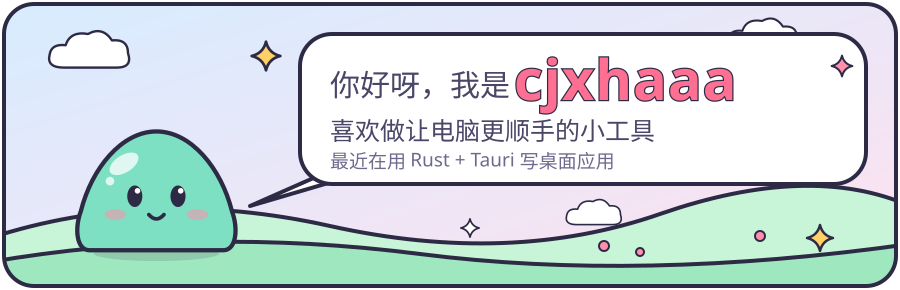
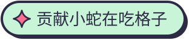

  

  
  

  <picture>
    <source media="(prefers-color-scheme: dark)" srcset="https://skillicons.dev/icons?i=rust%2Cts%2Creact%2Ctauri%2Cgo%2Cpython&amp;theme=dark">
    
  </picture>

更早还写过一些 Go / Python 的小项目（爬虫、代理池、跳表……），都在仓库列表里。

  <picture>
    <source media="(prefers-color-scheme: dark)" srcset="https://raw.githubusercontent.com/cjxhaaa/cjxhaaa/output/github-snake-dark.svg">
    
  </picture>

  

